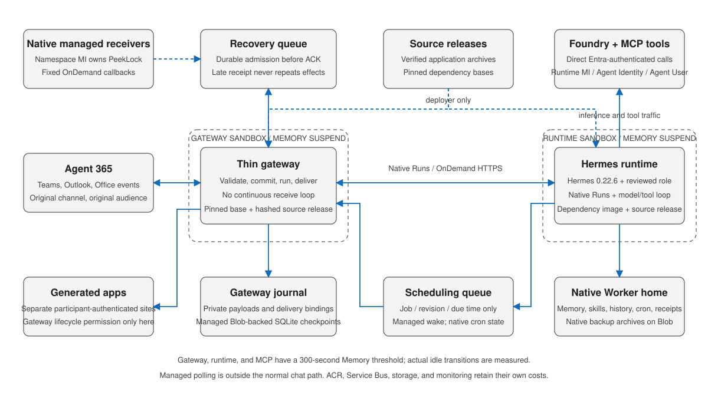

# Hermes on Azure

A Junior Project Manager digital Worker: Hermes 0.22.6 in Memory-suspended Azure Container Apps Sandboxes, Microsoft Agent 365 for Teams and Microsoft 365, native Service Bus wake, and Foundry `gpt-6.1-sol` with Entra-authenticated inference.

Each Worker owns its identity, persistent state, memory, and skills. Hermes learns natively; the Worker owner reviews each change, and local learning becomes shared behavior only through signed Learning Packets, human-reviewed Git Promotion, and Worker Refresh.



## Start

From the repository root, with existing Worker state and an Azure login:

```powershell
Set-Location .\autopilots-on-azure
uv sync --frozen
uv run python -m scripts.demo_ops
uv run python -m scripts.demo_ops smoke --state-name hermes2 `
  --message "Reply exactly: Hermes ready" --timeout 600
uv run python -m scripts.event_transport_smoke --state-name hermes2
```

The no-argument command checks the `hermes` Worker; the smoke test asks `hermes2` for a real model reply. The deployment pins Hermes 0.22.6 with native learning, user scheduling, Service Bus Dreaming, private journal checkpoints, and Blob-volume backups.

## Read next

Three architecture documents, each an interactive HTML page (hover or pin any diagram component) with an offline copy and a printable PDF:

| Document | Contents | Offline and print |
| --- | --- | --- |
| [Architecture](docs/architecture.html) | Operating model, conversation turns, identities, documents, state and recovery | [Standalone](docs/architecture.standalone.html), [PDF](docs/architecture.pdf) |
| [Collective learning](docs/collective-learning.html) | Memory layers, native learning and owner review, signed packets, Git Promotion, Worker Refresh | [Standalone](docs/collective-learning.standalone.html), [PDF](docs/collective-learning.pdf) |
| [Azure implementation](docs/azure-implementation.html) | Deployed topology, roles, Terraform layers, suspend behavior, telemetry, production network | [Standalone](docs/azure-implementation.standalone.html), [PDF](docs/azure-implementation.pdf) |

Then:

| Document | Contents |
| --- | --- |
| [Architecture decisions](docs/adr) | Current choices and rejected alternatives |
| [Deployment](DEPLOYMENT.md) | Worker updates, fresh Worker bootstrap, validation, diagnostics, teardown |
| [Demo](DEMO.md) | Prompts and observable results |
| [Specification](SPEC.md) | Domain, identity, lifecycle, learning, and current limitations |
| [Identity runbook](docs/runbooks/identity-mcp.md) | Consent, federation, and MCP troubleshooting |

After editing a document, refresh, validate, bundle, and print it from `docs` (needs Playwright with Chromium or Edge):

```powershell
Set-Location docs
node assets\sync-head.js architecture.html
node assets\validate.js architecture.html
node assets\bundle.js architecture.html
node assets\export-pdf.js architecture.standalone.html
```

## Boundaries

Gateway, runtime, and both MCP services have a five-minute Memory-suspend threshold. Actual idle transitions are observed, not assumed. The gateway commits private work and a managed recovery message before ACK, then immediately calls native Runs over OnDemand HTTPS. Native receivers own scheduling/recovery waiting; late recovery callbacks settle completed work without running the model again.

For Agent 365 federated authentication, the gateway retries only managed-identity assertion connection resets, at most twice after the initial attempt, with 0.2 and 0.4 seconds of backoff and per-attempt connect/read timeouts of 2/3 seconds. Other authentication failures are not retried. This does not establish that a previous Teams failure was caused by cold start or that the channel will redeliver a failed request.

Routine source updates preserve compute IDs, URLs, and Agent 365 identities. Only the heavy runtime dependency base needs ACR; thin services use a pinned public Python image. Operator requests return durable `202` admission and are polled rather than held open across a long model call. Native backups recover the Worker home; a separate gateway journal preserves admission, native run IDs, private payloads, and recovery receipts. Stopped CPU/RAM is not a zero bill for storage, Service Bus, ACR, or monitoring.

Managed source polling can take tens of seconds, so it is deliberately outside the normal chat path. [ADR 0015](docs/adr/0015-service-bus-backed-hermes-cron.md#receiver-timing) records why the slower request/result-queue design was rejected.

On 2026-11-05, the real `hermes2` warm check returned both MCP tool results in **26.7 s** and an exact model reply in **11.8 s**, with unchanged native transcript on replay. These are observed end-to-end timings, not a model or platform SLA; the smoke enforces its response limit separately from idle and recovery checks.

Foundry registers an external agent, not Hosted Agent compute. `scripts.worker_lifecycle` manages whole Workers; fresh Teams package upload stays manual. Shared group conversations are not private storage. [SPEC.md](SPEC.md#current-limitations) lists the remaining boundaries.
